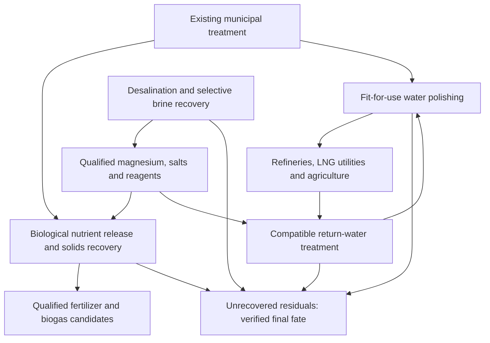

# Corpus water, bioreactor and resource-recovery network

Version0.6, October24 2026. PROPOSED/SIMULATED. No physical deployment, complete footprint, quotation, qualified product or import displacement established. Passing software tests validates bookkeeping, not treatment performance.

## Design question

Combine desalination/brine recovery with existing municipal treatment, biological resource recovery and nearby customers. Compare a single recovery campus with a connected network of treatment sidecars. Bioreactors are a central design element. They are not one interchangeable device: biological water treatment, anaerobic digestion, fermentation/nutrient release and candidate biomass production have different feeds, kinetics, energy balances and residuals.

The regional network can share laboratories, operators, utilities, appropriate heat, recovered reagents and residual equipment while retaining separate saline, organic, industrial and potable trains. No bulk mixing of seawater brine into municipal biology is assumed. Shared assets must have spare capacity and compatible chemistry. No relocation or demolition of existing WWTPs is assumed.

## New local evidence

The Greenwood permit application describes existing8MGD design capacity and anaerobic digesters, with12/16MGD future phases. These capacities are not actual measured flow. The separate Oso–Greenwood reuse program's announced16MGD is not Greenwood's currently operating capacity. The city'sFY25quarter3capital report separately describes a102mUSD rehabilitation project that includes elimination of primary treatment and anaerobic digestion, withJanuary2029listed completion. Actual configuration and project status require reconciliation. Do not assume existing biogas recovery, spare digestion capacity or centrate supply.

Primary permitPDFpages40and196 were visually checked. OneSeptember3 2024treated-effluent sample lists:

| Constituent | Result, mg/L | Qualification |
|---|---:|---|
| Total phosphorus | 3.2 | Not necessarily all reactive phosphate |
| Ammonia-N | 0.08 | J-estimated, below0.1mg/L reporting limit |
| Nitrate-N | 15 | Holding-time flag; not ammonium |
| Chloride | 509 | Chloride ion, not disinfectant chlorine |
| Total dissolved solids | 1,432 | Includes chloride and other salts; do not add constituents again |

These are historical observations, not current averages, permit limits or a mixed Oso/Greenwood assay. The summary table'sTKNaverage1.89/max1.88internal inconsistency is retained and no reliableTNis inferred. New assays must include phosphate speciation, ammonium, N forms, Mg/Ca/Na, salts, COD/BOD, solids, PFAS/metals, microbes and microplastics.

## Resource-routing concept

The diagram identifies candidate interfaces, not approved transfers. Biogas applies to organic feeds; inorganic brine solids are not fuel. Nutrient release precedes chemical struvite crystallization; the crystallizer is not itself a bioreactor. Conventional nitrogen removal toN2can support compliance but does not produce recovered fertilizerN. Consider capturing or preserving ammonium upstream before converting or removing it. Existing biological treatment may be retained or adapted after engineering review.

## Water output and customer allocation

The city has an existing thirty-yearValeroagreement: initially up to3MGDTypeIIreclaimed water, potentially8MGDafter infrastructure work. This is committed baseline service, not new Atlas water or an unallocated supply.

For an assumed16MGDavailable reuse feed, three separate hydraulic scenarios illustrate tradeoffs:

| Assumed treatment split | Reusable water | New advanced-treatment residual |
|---|---:|---:|
| All advanced treatment at90% recovery | 14.4MGD | 1.6MGD |
| Half fit-for-use, half advanced at90% | 15.2MGD | 0.8MGD |
| All qualified for direct fit-for-use treatment | Up to16MGD | Advanced-ROreject zero in this simplified split |

Direct fit-for-use still requires applicable treatment and testing. It is not untreated discharge, free conditioning or proof ofZLD; sludge, cleaning water and other losses remain outside this simplified hydraulic split. Vendor costs/yields and actual authorized flows remain unknown.

Reserving8MGDfor theValerocontract leaves arithmetic remainders6.4/7.2/8MGDrespectively, before other contracts, environmental obligations, downtime, distribution losses and quality needs. These remainders are not an actual new allocation. The existing16MGDprogram must be in the counterfactual. No automatic16MGDsubtraction from a30MGDdesal requirement is justified.

Separate customers and duties:

- Petroleum refineries: cooling, process water and more highly conditioned boiler makeup. Actual metallurgy, scale, silica, organics, microbial and salinity limits govern treatment.
- Cheniere: LNG liquefaction/export, not a petroleum refinery. Establish actual utility demand, cooling configuration, temperature, pressure, distance and return flows before allocating reclaimed water. No regasification cold credit.
- Agriculture: crop-specific authorized reclaimed water. Pathogens, salts, sodicity, boron/chloride, contaminants and actual nutrient application determine suitability. Avoid blanketROif acceptable lower-cost treatment suffices; do not infer thatTypeIIstatus guarantees agronomic suitability.
- Local AI/industry: actual useful workloads and cooling makeup, not presumed hyperscale demand.

Recirculation reduces makeup but cannot recover evaporation or eliminate salts. An illustrative10MGDcirculation loop with5%evaporation and95%recovery of the remaining return water needs0.975MGDmakeup and generates0.475MGDliquid purge, plus0.5MGDevaporation. It does not create9MGDof new supply. Purge joins the residual ledger; organics, scale and microbial control require actual designs.

An illustrative1MGDagricultural allocation,85%distribution efficiency and2–4acre-ft/acre/yearapplied duty corresponds to238–476acres annually. This is not located land, a crop recommendation, a water right or proof of seasonal adequacy. Irrigation includes consumptive evapotranspiration and salt accumulation/return-flow duties; it is beneficial reuse, not a physically closed water loop. Do not count the same water for industry and agriculture simultaneously.

## Struvite, trace ammonia and purchased supplementation

The theoretical reaction needs one mole each ofMg, ammonium-N andP. Nitrate is not ammonium. Using the historical chemistry at an assumed8MGDgives96.91kg/daytotalP and2.42kg/dayammonia-N. If all the ammonia were available and magnesium adequate, Nlimits struvite to42.45kg/day. Even trace concentration matters at scale, but thisJ-estimatedsingle result is not a dependable supply measurement.

Supplementation is allowed as a design option. Three source cases are modeled separately: recovered local sidestream ammonia, domestic purchased ammonia and internationally imported ammonia. Local recoveredNneeds its own source inventory; importedNis an input, not recoveredN.

| 8MGD illustrative case | Struvite, theoretical | Added pureNH3equivalent | P incorporated | Mg incorporated |
|---|---:|---:|---:|---:|
| Native observed ammonia only, ideal ceiling | 42.45kg/day | 0 | 5.36kg/day | 4.20kg/day |
| Target80%of totalP, assumed reactive | 614.23kg/day | 39.68kg/day | 77.53kg/day | 60.83kg/day |
| Target100%of totalP, ideal ceiling | 767.79kg/day | 50.34kg/day | 96.91kg/day | 76.04kg/day |

These are stoichiometric alternatives, not achieved process yields. Purchased aqueous ammonia delivery has a different mass than pureNH3equivalent. Reactive phosphate fraction, side reactions, pH/alkali, concentration, contaminants, real capture and product acceptance remain unresolved. Model inputs permit zero/.08/.1mg/Lnativeammonia sensitivities. The16MGDcase merely doubles assumed flow with identical chemistry; it does not establish mixed-program composition.

At an assumed300/600/1000USDpertonnepureNH3-equivalent, the80%case's ammonia-only cost is11.90/23.81/39.68USD/day. These are explicit price assumptions, not market quotes or complete treatment costs. No projectprofitability follows from them. Compare upstream biological nutrient release, sidestream ammonium capture, added ammonia and calcium-phosphate recovery without ammonia using full lifecycle costs. Supplementation may helpP-recovery economics while increasingNimports; both belong on the ledger.

The base brine model'sMgallocation is finite. Redirecting60.83kgMg/dayfrom its hydroxide lane reduces theoreticalMg(OH)2output by145.97kg/day. It cannot remain in both sales and struvite totals. This allocation is small relative to modeled capturedMg; wastewater P/Navailability, chemistry and markets may constrain nutrient production beforeMgdoes.

## Footprint: quantify components without inventing a campus layout

Co-location adds treatment, storage, chemical handling and residual modules; shared utilities can avoid duplication. It does not automatically shrink total site area. A network may reduce bulk sludge conveyance by locating biological release/recovery atWWTPs, while forwarding clean water, qualified reagent or product to a central mineral hub.

Geometry-only tank calculations use explicitly assumed5mdepth and1.5xwater-surface area for a tank plot:

| Assumed flow | Storage/equalization | Volume | Illustrative tank plot |
|---|---:|---:|---:|
| 8MGD | 8hours | 10,094m3 | 0.75acre |
| 16MGD | 8hours | 20,189m3 | 1.50acres |
| 16MGD | 24hours | 60,567m3 | 4.49acres |

The factor is an analyst geometry assumption, not a design standard. These plots exclude treatment equipment, sludge processing, digesters, drying, roads, safety setbacks, flood resilience, buffers and redundant trains. Biological tank scenarios separately test6/12hourmainline duties and15/25daysfor assumed0.1/0.5MGDsolids-digester feeds at6mdepth. They are not vendor sizing or a claim that the entire wastewater stream should spend weeks in a digester.

Actual total campus footprint remains null pending available-area survey, existing-asset capacities and vendor general-arrangement drawings. Road/pipeline rights-of-way and agricultural production land are separate from plant acreage. No quantified footprint saving versus a separate plant is claimed.

## Industrial/agricultural products and imports

The recovered-product register now explicitly links chloride and other products to uses. Potential pathways include purifiedNaClchemicalfeed, HClcleaning/pHcontrol, NaOHalkali, qualifiedhypochloritedisinfectant, KCl/K2SO4fertilizer, Mg-basedindustrial/cementproducts, qualifiedgypsum/CaCO3, brominechemicals and recoverednutrientfertilizers. Trace lanes remain assay-dependent.

These have different specifications. Chloride ion is not elemental chlorine; changing salt intoHClorCl2requires a process and energy, andHClused internally may returnClto residual water. The model retains competingNa/Clallocations; NaCl,BMEDandchloralkalicannot each consume the full stock. NaOHused forMgprecipitation cannot also be sold. Kchlorides may suit some fertilizer markets but harm chloride-sensitive crops. Brine is not directly a fertilizer or mortar.

Scaling the historicalGreenwoodsampleto8MGDimplies15.41tonnes/daychloride within43.37tonnes/dayTDS. At16MGDthose figures double, but mixed-program chemistry is unverified. Dissolved inventory is not saleable salt yield; ions overlapTDS, Naavailability is unmeasured and wastewater contaminants can disqualify a mineralproduct. Avoid contaminating clean brine product lanes through indiscriminate mixing.

Three accounts remain distinct: resource recovery; actuallocalpurchase/substitution; verifiedinternationalimportdisplacement. AGulfCoastbuyer may currently buy domestic chemicals. A verified import offset requires buyer origin/quantity, accepted equivalent grade, actual use and net delivered cost. Output cannot count as a national import offset merely because it is useful. National commodity statistics alone do not establish this project's imports displaced. All actual import-offset inputs remain unknown and realizedcreditszero.

Struvite reports elementalP/NandP2O5equivalent separately. It is not tonne-for-tonneDAPequivalent. Added importedammonia is explicitly recorded; chemical products incorporating external reagents do not become100%recoveredwasteby mass. Prices and absorbed market volumes remain unknown.

## Delivery and contract-review integration

The nine-point proposal is retained with tighter safeguards: salary and verified expensesTBD; no automatic spend-linked management fee; independently establishedGMPandquantitybaseline; capped verified savings and product-value incentives; actual avoided-purchase value; holdback; commissioning/quality/residualgates; contractor notice,responseanddisputeprocess. AI flags inform humanreview and cannot automatically impose penalties, blame or investigation. Comparable operating service and full lifecycle costs determine savings, not firstwateralone or underspendingan inflatedbaseline.

DeepSeek's2025/2026costmix and ten-monthboundaryerror are corrected. ExactPearland40/60andHollywoodsharingexamplesremainunverified and are not adopted. The primaryKalaeloaSECfiling clarifies that11.533546mdevelopment is **included in**149.648118mdesign-build, describes an indirectwhollyownedsubsidiary and provides a20yearpostacceptanceterm with fixed/variableservicepayments and delivery/qualityguarantees. It does not prove twentyyears of operatingperformance. TheJune2026filing describes continuingdesign/development and delayedconstruction. A signedDBOMcontractis a useful mechanism reference, not proof that its delivery problems are solved.

All historicalCorpusestimates remain unchanged. Newbioreactor, storage, polishing, ammoniahandling and residualdutiesremain explicitnullcosts. Source receipts retain dates,pageanchors,assayqualifiersanddocumenthashes without republishing fullPDFs.69bookkeepingtests pass; environmentalclearance and all-inbudgetremainunresolved.
