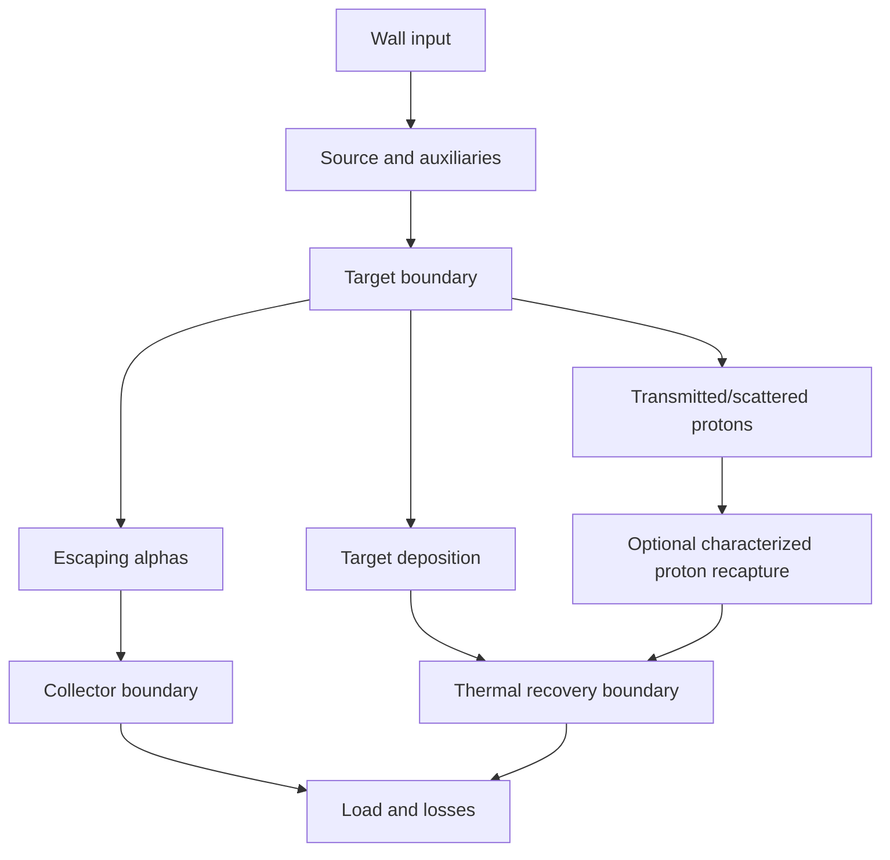

# STARS 2.0 implementation-contract candidate v0.2
Status: PROPOSED — project-lead scientific approval pending. No blinded prediction release.
Parent: GPTWork package STAGE_3_OPTIMIZED_WORK_ORDER_CANDIDATE_v0_1.md.
Review input: [Tidal Lantern Stage 4](../reviews/GPTWORK_COUNCIL_STAGE4_INDEPENDENT_GAP_REVIEW_v0_1_2026-10-27.md), reviewed blob 1a0a8a4bb84140da80db16b711a9ccd4c2aa2458.
Original package: STARS_GPTWork_Council_Review_v0_1.zip, 110073 bytes; retain its independent SHA-256 receipt on ingestion.
Change policy: new versions only; preserve original sources, reports and failed runs.

## Decision and scope
Accept the Stage 4 additions. Identifiability precedes interpretation of geometry optimization. Prepare two independently useful outputs: A, a portable nuclear-data/event/transport/diagnostic framework; B, a separately versioned STARS p–11B configuration. Neither a software pass nor a successful source import is empirical calibration.

The immediate implementation milestone, after explicit project-lead approval of this candidate, is the source/observable vertical slice. A synthetic identifiability harness can follow immediately; its empirical qualification depends on material and detector evidence. This avoids postponing experimental-design analysis until after a large simulator is built.

## Mandatory requirements and acceptance evidence

| ID | Requirement | Acceptance evidence | Current state |
|---|---|---|---|
| A1 | Retain source quantity kind, LAB/CM frame, units, uncertainty, acceptance and transformations | Exact 41-point reproduction; reject implicit alpha/event conversion; retain nonzero energy uncertainty | Numeric reproduction passed previously; typed implementation pending |
| A2 | Common uncertainty is represented once per shared source/calibration group | Synthetic covariance tests distinguish common nuisance from independent per-row noise; source overlap registry | Pending |
| B1 | Physical masses, Q and Lorentz transforms | Independent external four-vector oracle; inverse boosts; threshold tests; eventwise closure with justified error budget | Pending |
| B2 | Correct distributions as well as conservation | Source-qualified channel/angle/energy tests and detector-folded held-out distributions; isotropic and phase-space nulls explicitly labeled | Source evidence needed |
| C1 | Layer-specific transport and bounded input domains | Multi-energy transmission, range/inverse consistency, geometry analytic limits; missing required material blocks calibrated mode | Source qualification pending |
| C2 | Detector forward response | Independent species/energy/angle/live-time calibration and held-out blank/background checks | Facility evidence needed |
| D1 | Joint identifiability | Sensitivity rank plus profile/posterior degeneracies; recovery and coverage over synthetic nuisance scenarios; list identifiable combinations | Toy demonstration only |
| D2 | Grouped holdouts | Immutable assignment by campaign, target batch and calibration cycle; exposure history; blocked energy/geometry stress tests | Design pending |
| E1 | All-shot causal accounting | Every randomized attempt retained with outcome/missingness reason; total accepted energy per attempted shot, qualification rate and conditional metrics reported separately | Toy selection counterexample only |
| E2 | Physical wave/stress comparison | Measured M,C,K and forcing/transfer response; conventional modal/FEM comparator; held-out specimens and drive conditions | Not run |
| F1 | Explicit energy-flow boundaries | Boundary graph, directed flow ledger, deposited/exiting/stored terms, zero-sigma and recapture fixtures | Conditional historical defect found |
| F2 | Robust collector decision | Acceptance over same source phase space; uncertainty bands and near-optimal region/regret; no forced optimum | Not calibrated |
| G1 | Reproducible release | Source/license registry, citation metadata, pinned environment, machine reports, independent rerun and second reaction example | Partial exploratory receipts |
| G2 | Blind release governance | Qualified interfaces, frozen scores and predictions, independent custodian and explicit project-lead authorization | BLOCKED |

Pass thresholds must be justified before scoring. Parser fidelity uses exact decimal/unit conversion where possible. Conservation tolerances follow floating-point and algorithm error analysis. Experimental residual limits and sample sizes require instrument uncertainty, precision/power and multiplicity analysis; this candidate supplies no invented percentages.

## Work packages and dependencies
1. Recover immutable source registry: distinguish archived early generator from later correlated Gemini v0.4 by bytes, path and hash. Preserve both. Later v0.4 plus five outputs remains an outstanding acquisition/reproduction task. It blocks claims about that implementation, not independent source/parser work.
2. Build observable slice and regression fixtures for uncertainty loss and undefined zero-baseline ratios. Undefined ratios use null with a reason, never fabricated zero or JSON NaN.
3. Develop independently verified kinematics and one material/detector interface. Carry unqualified inputs only in explicitly marked exploratory runs.
4. Start synthetic design/identifiability analysis early; qualify joint inference when C1/C2 data exist. If parameters cannot be separated, report combinations or bounds and specify the extra measurement needed.
5. Evaluate wave/stress methods as a separate research track; integrate with nuclear experiments only through measured mediators.
6. Evaluate collector and full ledger using calibrated phase space. Publish nulls and unresolved residuals.
7. Independent reproduction and portability demonstration; only then consider prospective blinded predictions under separate authorization.

## Grouped holdout and causal rules
Declare the experimental unit and shared-error graph. Splits must prevent a calibration cycle or target batch from appearing in both fitting and its claimed independent validation. When campaign structure makes this impossible, label the validation scope honestly. Do not infer independence from different shot IDs.

Freeze primary estimands, exclusion/missing-data rules and uncertainty handling before unblinding. Keep all randomized attempts in the primary accounting. A missed outcome is missing, not zero. Where missingness depends on treatment, report sensitivity/bounds. Qualification-conditioned means are operational descriptions; they do not inherit unconditional randomization.

Detector-space counts, proton transmission and alpha spectra should be jointly forecast. Compare plausible discrepancy models and prior sensitivity. Test false-positive rates and interval coverage under null and misspecified scenarios before adopting a likelihood.

## Energy boundary contract

Nuclear Q enters only for valid reaction events. The graph is a boundary specification, not a claim that recapture or recovery hardware exists. Track time-dependent electromagnetic storage, other particle/radiation exits and unresolved residuals explicitly. Collector losses enter thermal recovery only through an explicit measured/model-qualified connection.

Every flow carries origin, destination, units, integration window, source/model ID, covariance group and inclusion state. Test both proton-recapture absent and present, with identical transmitted stream: heat cannot be credited twice or assigned before it crosses the recovery boundary. The prior 5.7621e-7 J discrepancy is conditional on its specific fixture and boundary, not a plant correction.

## Spectral experiment contract
Begin with M u_tt + C u_t + K u = F, or a justified material-specific alternative. Record units, mass/stiffness/damping identification, boundary conditions, sensor/actuator locations and uncertainty. The finite toroidal Laplacian is an analytical benchmark; demonstrate a mapping before using it for a specimen.

Compare conventional modal/FEM and proposed spectral reduction with the same training observations, computational budget and held-out specimens. Score transfer magnitude/phase, displacement and stress prediction, runtime and retained degrees of freedom. Require accuracy improvement at matched cost, or reduced cost within a prespecified accuracy margin derived from sensor resolution and use requirements.

Equal measured displacement and equal actuator input are separate comparisons. Include thermal drift, target age, strain/curvature, threshold duration and calibrated fatigue measures. Failure to outperform the conventional comparator is a valid result. Local-smoothing applicability and proof verification remain separate tasks; no theorem-based material guarantee is assumed.

## Release and approval record
Publish append-only source, assumptions, seed/environment, code/output hashes and known failures. Preserve original license terms; code licensing does not relicense third-party data. A hash establishes identity, not truth or independent validation.

Requested project-lead decision: approve or amend this v0.2 candidate as the bounded implementation contract for A1/A2 and exploratory design infrastructure. Approval must identify the accepted version and scope. Empirical calibration, canonical scientific acceptance and G0-B prediction freeze retain their separate gates.

Stage 4 independent gap review is complete as documented by Tidal Lantern. This candidate has not itself received project-lead final scientific approval.
