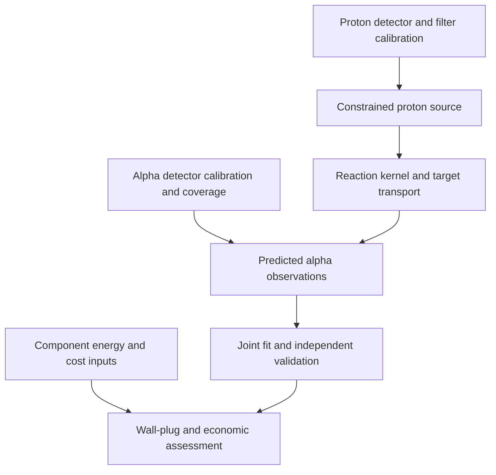

# Disposition of additional calibration suggestions

Accepted: select source/diagnostic benchmarks using filter-stack completeness, raw-data availability and normalization first; retain applicability, independence and failure-consequence fields. Known nominal thickness is not measured transmission with uncertainty. Plot digitization is a separate evidence class from raw counts.

Clarifications:

- v0.11 used piecewise-linear interpolation, not a spline. Its leave-one-out residuals remain evidence that this simple reference is insufficient for high-accuracy calibration. Fitting a more physical model may help, but neither Bethe-like stopping nor an etch model automatically validates extrapolation into7.5MeV coverage.
- Greater alpha energy does not universally give larger tracks. The recovered2019 response decreases above its maximum. Overlap depends on fluence, etch/readout and species-specific diameter distributions. New2023 evidence emphasizes undetected small proton pits and tails, not a universal high-energy saturation rule.
- Keep the16.11MeV2+ source separate. Laursen2016 reports dominant d-wave emission to excitedBe8; a generic statement that this state is predominantly l=0 should not be frozen into the model.
- Do not invent a probability band for an uncalibrated2-minus source. Report justified model alternatives/sensitivities; label unknown physical uncertainty until constrained. No arbitrary20% or30% interval becomes measured evidence.
- A discrepancy GP is optional and must be justified. A30% amplitude cap or a resolution-based length scale is not automatically a defensible prior. Raw-count likelihood, calibration nuisances and explicit forward resolution should precede flexible corrections. Independent holdouts and prior sensitivity remain required.
- An OFF baseline receives no unmeasured acoustic enhancement credit. This is different from claiming every physical effect of ON acoustics is zero. Qualified target/beam effects may enter mechanistically; unqualified ON effects and costs remain unknown. Retain adverse and null sensitivity cases, not only gains.
- A single-laboratory dataset can be a reproducible reference benchmark while lacking independent experimental validation. Fitting one campaign is calibration; testing held-out campaigns is validation. Agreement between two diagnostics in one campaign does not establish full independent-systematics control.

The dependency order has parallel lanes. Proton TPS validation does not require7.5MeV alpha calibration, and energy/cost data can be collected while detector work proceeds:

Passing a reference TPS benchmark qualifies an implementation for that setup. It does not independently measure the proton source of a future Stars apparatus.
