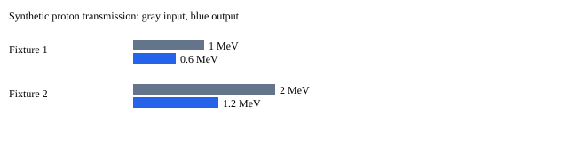

# Stellar Forge Reference v.1 — verification demo

Experiment: pb11-verification-fixture-001

**SYNTHETIC FIXTURES. No calibrated p–B prediction, ignition or net-power result.**

Transported alpha fixture spectra are connected to the detector response. Nuclear births are externally supplied rays. The energy scenario and identifiability toy are separate calculations, not predictions from that transport.

| Proton fixture | Input MeV | Transmitted MeV | Primary loss MeV |
|---|---:|---:|---:|
| 1 | 1 | 0.6 | 0.4 |
| 2 | 2 | 1.2 | 0.8 |

Detector expected counts: [78.0, 54.0]; undetected weight: 25.00000000000001. No random shot counts generated.

Standalone assumed energy scenario: -100.0 J net; ignition NOT EVALUATED.

Installed CAPEX: UNRESOLVED USD. Source audit: NOT_RUN_NO_SOURCE_FILE.

Scientific outcome: NOT_TESTED. Economic snapshot: 2026-10-28 (USD).
Products: no products declared. Priced-subset potential gross: $0; all products valued: True.
Potential net: UNRESOLVED; missing cost categories: electricity, extraction, purification, storage, transport, capital_allocation, other_operations. Realized revenue: NOT RECORDED.

## Unimplemented physical and experimental gates

- physical mass-correct correlated event generation
- connected nuclear event rates
- scattering/straggling
- dynamic burn and ignition
- all-shot causal inference
- grouped experimental validation
- full-cycle storage ledger
- complete reaction/decay/recovery network
- qualified market prices and full CAPEX
